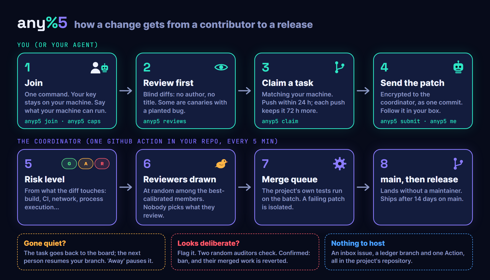

# any%5

**A way to run an open-source project where anyone can contribute from day one, nothing waits on a few
maintainers, and every change is checked by reviewers who do not choose what they review.**



https://github.com/user-attachments/assets/7324ee94-aff9-45b5-b625-42cddab37499

any%5 is a proposal to discuss, not a finished product. It has been measured in simulation and tested end to
end on GitHub, and this repository runs on it. No project with real outside contributors has used it yet.
Questions, objections and attempts to break it are welcome in [issues](../../issues) and
[discussions](../../discussions).

## The problem

Coding agents made writing code cheap. Reviewing it did not get cheaper. Many projects now receive more pull
requests than their maintainers can read, so they close the door: "10 merged PRs before you can open one",
collaborator-only PRs, intake pauses. Newcomers wait for weeks, a handful of insiders become the bottleneck,
and a patient attacker can still earn trust and then ship a backdoor, as in xz-utils (2024).

any%5 asks a different question: if everyone who contributes also reviews, can the crowd check itself, without
anyone having to be trusted?

## How it works

A 4-minute walkthrough: how contributors use it, what happens to a patch, and the maintainer setup.

https://github.com/user-attachments/assets/5fed5c7e-0953-41d7-8da8-f761f5d0b4a3

1. **Work is leased, never owned.** Members say what their machine can run (for example `windows`, `gpu`) and
   claim a matching task. They keep it while they push: first push within 24 h, each push renews for 72 h,
   5 days at most unless a reviewer confirms real progress. Someone who goes quiet loses the task and the next
   person resumes their branch. An "away" command pauses the lease within limits.
2. **Jury duty instead of reputation.** No reputation is needed to contribute, and none buys lighter checks.
   Assigned reviews come before new work.
3. **Risk is judged from the diff, not the author.** A bot tiers each change green, amber or red from what it
   touches (build scripts, CI, dependencies, network, process execution, memory protection). Riskier changes
   get more reviewers and a check after merge.
4. **Reviews are blind and calibrated.** Reviewers see a diff without its author or title. Some reviews are
   *canaries*: copies of pending changes, either left clean or with one planted bug. Catching the bug counts
   only if the reject names its line, and rejecting a clean copy counts against the reviewer. Reviews are drawn
   from the best-calibrated members, at random, so nobody picks what they review.
5. **Merge fast, release after a soak.** Approved changes are tested together in a merge queue and land on
   `main` without waiting for a maintainer. A release only contains changes that spent 14 days on `main`.
6. **Ban and revert.** A backdoor claim goes to two randomly drawn auditors. If they confirm it, the author is
   banned, their merged work is reverted, and what their approvers passed is checked again. Honest bugs never
   cost anyone their membership.

The full rules and their reasons: [docs/METHOD.md](docs/METHOD.md).

## Results

Simulation of 10,000 contributors over 90 days: 1 % lone attackers, 1 % colluders in rings of 5, a
reject-all ring of 5 % of members, 20 % careless reviewers, honest reviewers who wrongly reject 3-10 % of
clean changes. People come and go (about 17 % online at a time). Mean of 5 seeds.

| | Trust levels + review credits | any%5 v0.4 |
|---|---:|---:|
| Changes merged per day | 2,032 | 2,339 |
| Median time to merge | 17.6 h | 3.0 h |
| Honest changes closed by wrong rejects | 17.7 % | 0.4 % |
| Backdoor attempts that reach `main` and survive the 14-day soak | 23-26 % | 18-19 % |

With only insiders allowed to submit and review, merges fall to 0 per day by day 90, because insiders leave
and are not replaced.

What this shows and what it does not:

- **Throughput is the solid result.** It grows linearly from 10 to 100,000 members, with no maintainer in the
  loop. It comes from jury duty and spare reviewers, not from the attacker model.
- **Safety improves, modestly.** About a quarter fewer backdoor attempts get through than with trust levels.
  An earlier rule set did better (15-16 %) but let a reject-all ring take over reviews and close 20 % of
  honest work; closing that hole cost a few points ([false rejects](sim/eval/false_rejects.md)).
- **No advantage against an xz-style attacker.** If a backdoor is subtle enough that most reviewers miss it,
  every design measured ships about 43 % of attempts. Calibration catches careless reviewers. It does not make
  anyone see what they cannot see.
- **It is a model.** Detection rates, presence and attacker share are assumptions. Trust the comparisons, not
  the absolute numbers. Method, tables and commands to reproduce: [docs/RESULTS.md](docs/RESULTS.md).

Five AI agents were given this repository and asked to break the method. What they broke is fixed and their
attacks are replayed in tests; what is left is listed in [docs/REDTEAM.md](docs/REDTEAM.md).

## How it runs

Nothing to host. Everything lives in the project's own repository:

```
contributor + agent ──(anyp5 CLI: sealed, signed comment)──> "anyp5 inbox" issue
                                                                    │
                                     GitHub Action "coordinator", every 5 minutes
                                                                    │
            anyp5-ledger branch (public)  <─────────────────────────┤
            anyp5-state branch (sealed)   <─────────────────────────┤
            anyp5-queue branch ──> project CI ──> main  <───────────┘
```

- Contributors send commands as encrypted, signed issue comments. Patches are sent privately, so a canary
  copy cannot be told apart from the original by looking at public PRs.
- The coordinator Action never runs contributor code. Approved patches are applied with `git am`, tested on
  the `anyp5-queue` branch by the project's own CI, and `main` only moves to a commit whose CI passed. A
  failing batch is split until the change that breaks it is found.
- Measured with the real coordinator up to 10,000 members: a 4 s pass every 5 minutes and about 3 MB of
  ledger growth per day ([bench/RESULTS.md](bench/RESULTS.md)). CI time is the real cost: about 60
  runner-hours a day at 2,400 merges with batches of 16 ([bench/RUNNERS.md](bench/RUNNERS.md)).

## Try it

**As a contributor** (or your agent, with the [contributor](skills/contributor/SKILL.md) and
[reviewer](skills/reviewer/SKILL.md) skills):

```sh
pip install "anyp5 @ git+https://github.com/tibzejoker/anyPercent5@v0.4.0"
anyp5 join --repo owner/name        # creates your key, posts the join request
anyp5 caps windows gpu              # what your machine can run
anyp5 reviews                       # jury duty first: diffs only, no author, no title
anyp5 verdict 12 reject --reason "src/parse.c:88 bound should be < len"
anyp5 tasks && anyp5 claim 3
git format-patch origin/main --stdout | anyp5 submit
anyp5 me                            # your changes, their state, your calibration
```

**As a maintainer**, from your project's checkout, with `gh` logged in as an admin:

```sh
pip install "anyp5 @ git+https://github.com/tibzejoker/anyPercent5@v0.4.0"
anyp5 setup --test "python -m pytest -q" --dry-run   # prints every step, changes nothing
anyp5 setup --test "python -m pytest -q"             # inbox issue, ledger branch, secret, workflows, local commit
git push origin main
```

It creates the inbox issue, the `anyp5-ledger` branch and the coordinator key secret, and commits the workflow
files without pushing them. What it does, step by step: [docs/GITMODE.md](docs/GITMODE.md#set-up-maintainer).
Alone, you keep pushing to `main` as before; any%5 handles changes from the first newcomer on
([small projects](docs/METHOD.md#small-projects-one-maintainer-then-the-first-newcomers)).

**With an agent**: give your agent [skills/maintainer/SKILL.md](skills/maintainer/SKILL.md) and ask it to
install any%5.

## This repository runs on any%5

Outside changes to any%5 go through any%5: join, review, claim a task from the board below, submit a patch.
The coordinator runs in [`.github/workflows/anyp5-coordinator.yml`](.github/workflows/anyp5-coordinator.yml).
Below 100 members, bans also need a maintainer's confirmation. See [CONTRIBUTING.md](CONTRIBUTING.md).

<!-- anyp5:wanted -->
| You can run | Open tasks | Waiting on others | Active members | Tasks per member |
|---|---:|---:|---:|---:|
| linux **wanted** | 6 | 0 | 1 | 6.0 |

Updated 2026-10-11 21:02 UTC. Declare what you can run with `anyp5 caps windows gpu ...`.
<!-- /anyp5:wanted -->

## Prior art

- **Closing the door**: collaborator-only PRs, PR caps, "N merged PRs first" gates. Simple, but they do not
  scale (see the insiders-only result above).
- **[Vouch](https://github.com/mitchellh/vouch)**: vouched and denounced lists shared across projects, with an
  Action that closes PRs from unvouched users. Good against spam, but it is still "trust the author", and
  vouching is a human bottleneck. The two combine: Vouch at the door, any%5 for throughput and checks.
- **cargo-crev and cargo-vet**: signed, shared code reviews for dependencies. Voluntary review stayed scarce,
  which is why any%5 assigns reviews.
- **Stack Overflow review audits, "gold questions" in crowdsourcing**: the canary idea, proven at scale. Their
  known failure, audits that look different from real work, is why canaries here are copies of pending changes.

## Limits

- **A subtle backdoor can still ship.** any%5 gives a change more and better reviewers. It does not make each
  reviewer smarter. Smaller diffs, sandboxed builds and evidence bundles ([evidence/](evidence/)) are the next
  levers.
- **Canaries must look real.** The built-in mutations are generic. Projects should add their own, mined from
  their past bug fixes ([how](docs/GITMODE.md#project-canaries)).
- **Rings recognise their own diffs.** A ring can mark its patches. The random draw keeps such a ring near its
  share of reviews, but blind review cannot hide a diff from the people who wrote it.
- **Direction is weak.** Maintainers open tasks and can name *architects* who approve task proposals. Nobody
  checks a change against a design.
- **The coordinator key is the trust root.** Whoever holds it can see which reviews are canaries.

## How the design was found

A first design (trust levels and review credits) was simulated and showed deadlocks and starved audits. Six
AI agents then designed a system independently, from the bare problem statement, and each implemented it in a
copy of the simulator. All six converged on the same core: random or ranked reviewers, no trust-based
bypass, leases, checks after merge, ban and revert. The designs were re-evaluated under the same conditions
and combined. Every design and simulator is in [sim/](sim/).

## Origin

Built while contributing to [AnyPS5](https://github.com/boykopovar/AnyPS5), when its PR intake was paused to
work through a backlog of agent-written pull requests. The name comes from speedrunning's *any%* category
(finish by any route) and from AnyPS5. Written with Claude Code: design, simulations, code, docs and video.

MIT licence.
